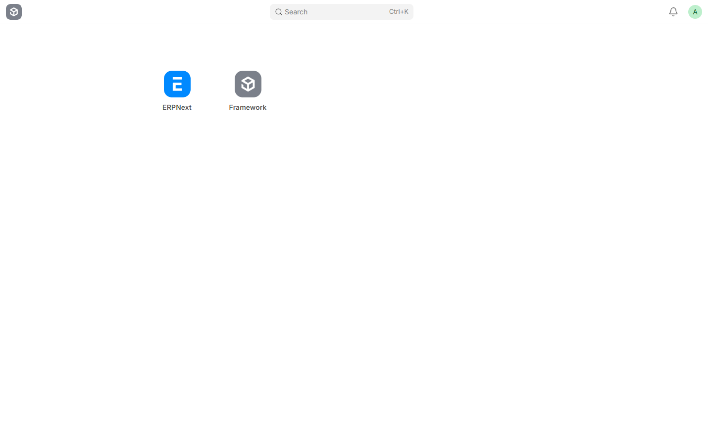
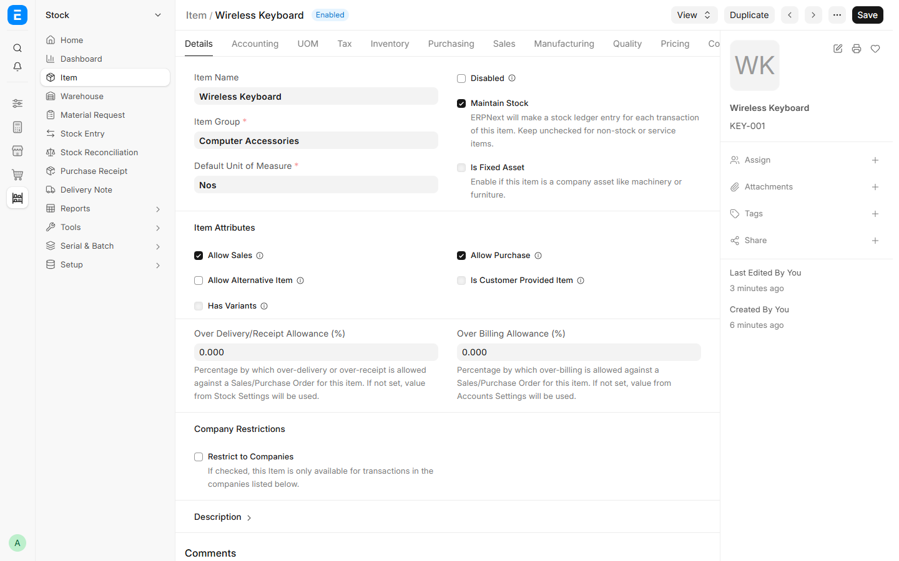
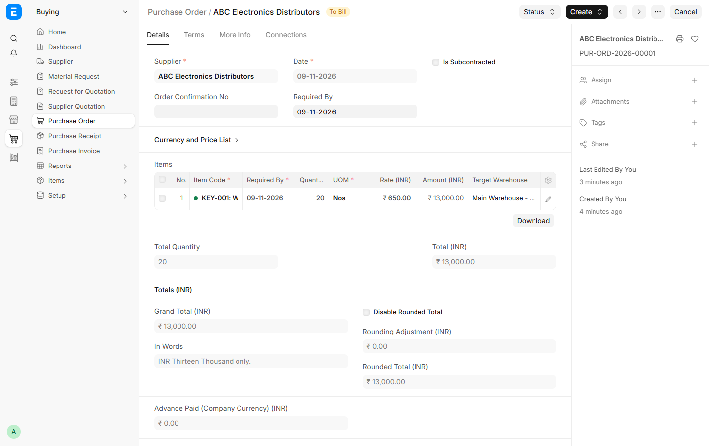
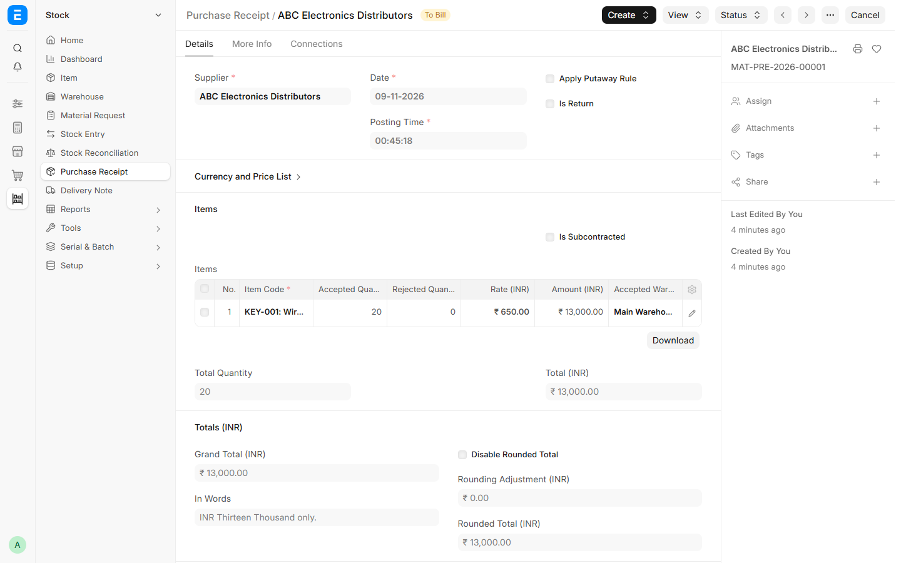
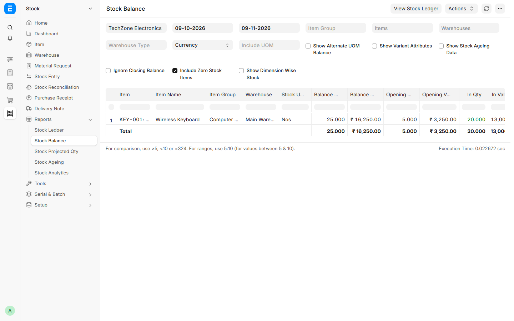
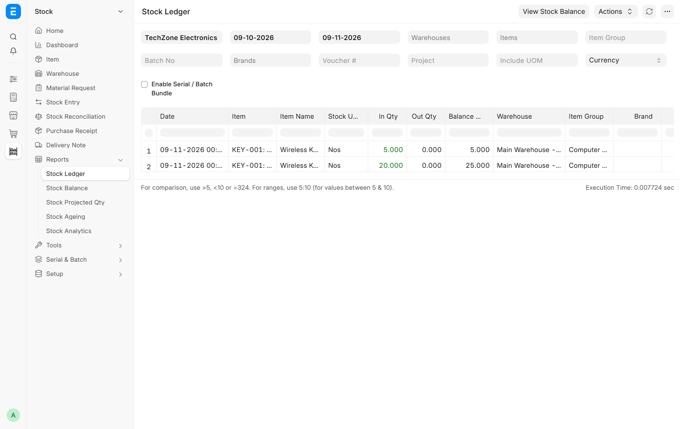

# Academic ERP Brochure: Inventory & Procurement Management

**Elective Course:** Enterprise Business Systems (EBS) — CSE Elective  
**Academic Year:** 2026–2027  
**Department:** Computer Science & Engineering  

---

<!-- ================= PAGE 1 ================= -->
# [PAGE 1: Enterprise Overview & System Architecture]

## 1. Project Title & Executive Summary

### Implementation of an Inventory and Procurement Management System Using ERPNext
**Case Study:** TechZone Electronics (Fictional Small Electronics Retailer)  
**Platform:** ERPNext (Open Source) deployed via Docker Compose  

> **Vision Statement:**  
> To demonstrate modern Enterprise Business System (EBS) fundamentals through a streamlined, end-to-end procurement and inventory management solution that eliminates data silos, automates stock accounting, and enforces transaction auditability.

---

## 2. Business Problem: The Electronics Retail Challenge

Small-to-medium electronics retailers face critical operational bottlenecks:
* **Manual Inventory Disconnects:** Spreadsheets fail to reflect real-time store stock, leading to stockouts of high-demand items.
* **Procurement Disorganization:** Verbal orders or informal emails result in pricing discrepancies and unverified shipments.
* **Audit & Valuation Deficits:** Lack of integrated accounting creates delays in calculating cost of goods sold (COGS) and inventory asset value.

**The Solution:**  
Implementing an integrated ERP solution using ERPNext to unite Purchasing, Warehousing, and Accounting into a unified, single-source-of-truth workflow.

---

## 3. System Highlights & Architecture

* **Containerized Deployment:** Powered by official `frappe_docker` multi-container architecture (MariaDB 11.8, Redis, Nginx, Python Frappe backend).
* **Zero Core Modifications:** 100% standard ERPNext business logic ensuring long-term maintainability and complete reproducibility.
* **Focused Footprint:** Unnecessary enterprise modules (HR, Manufacturing, CRM) are cleanly disabled to deliver an uncluttered, high-performance workspace.

### Core Modules Implemented
```
+-----------------------------------------------------------------+
|                    TECHZONE ELECTRONICS (ERP)                   |
+--------------------------------+--------------------------------+
|       BUYING / PROCUREMENT     |       STOCK / INVENTORY        |
|  * Supplier Master Management  |  * Item Master (KEY-001)       |
|  * Supplier Grouping           |  * Warehouse Master (Main Wh)  |
|  * Buying Price Lists (INR)    |  * Stock Reconciliation Entry  |
|  * Purchase Orders (PO)        |  * Purchase Receipts (GRN)     |
|  * Purchase Order Analytics    |  * Stock Balance & Ledger      |
+--------------------------------+--------------------------------+
|                AUTOMATED PERPETUAL INVENTORY ACCOUNTING         |
|  * Real-time Asset Debit (Stock in Hand)                        |
|  * Real-time Accrual Credit (Stock Received But Not Billed)     |
+-----------------------------------------------------------------+
```

---

## 4. Master Data Foundation

Before transactional processing, standardized master records were configured:

| Master Record | Entity Identifier | Key Specifications |
| :--- | :--- | :--- |
| **Fictional Company** | `TechZone Electronics` | Country: India \| Currency: INR (₹) \| Chart of Accounts: Standard |
| **Supplier Master** | `ABC Electronics Distributors` | Supplier Group: `Electronics Suppliers` \| Country: India |
| **Item Master** | `Wireless Keyboard` (`KEY-001`) | Group: `Computer Accessories` \| UOM: `Nos` \| Maintain Stock: Enabled |
| **Warehouse Master** | `Main Warehouse - TZE` | Company: `TechZone Electronics` \| Type: Stores |
| **Price Master** | Standard Buying | Rate: `₹650.00` per unit for `KEY-001` |
| **Reorder Buffer** | Item Reorder Rule | Reorder Level: `30 units` \| Reorder Qty: `20 units` |

---

## 5. Implementation Evidence (Master Data UI)

### ERPNext Workspace / Desk

*Focused ERPNext Workspace showing core Buying and Stock operational navigation.*

### Item Master (`KEY-001`)

*Wireless Keyboard master record showing physical inventory parameters, default warehouse, and standard buying rate.*

---
\pagebreak
<!-- ================= PAGE 2 ================= -->
# [PAGE 2: Procurement Workflow, Results & Verification]

## 6. End-to-End Demonstration Scenario

The core project demonstration validates one complete business cycle:
1. **Initial Inventory:** TechZone Electronics holds **5 wireless keyboards** in stock.
2. **Commercial Order:** Issuing a Purchase Order for **20 additional keyboards** to ABC Electronics Distributors at ₹650 each.
3. **Goods Receipt:** Receiving all 20 units into Main Warehouse via Purchase Receipt.
4. **Target Inventory:** Verifying physical stock increases from **5 to 25 units** strictly via the transaction.

```
[ Step 1: Initial Stock ]
  Stock Reconciliation (MAT-RECO-2026-00001) ----> Opening Stock: 5 Units (Valuation: ₹3,250)
                                                             |
[ Step 2: Commercial Agreement ]                             |
  Purchase Order (PUR-ORD-2026-00001) -----------------> Order: 20 Units @ ₹650 (Total: ₹13,000)
                                                             |
[ Step 3: Physical Fulfillment ]                             |
  Purchase Receipt (MAT-PRE-2026-00001) ---------------> Goods Received into Main Warehouse
                                                             |
[ Step 4: Verification & Audit Trail ]                       v
  Stock Balance & Ledger Reports ----------------------> Final Stock: 25 Units (Valuation: ₹16,250)
```

---

## 7. Verified Transaction Screenshots

### Purchase Order (`PUR-ORD-2026-00001`)

*Submitted Purchase Order for 20 units of KEY-001 at ₹650 (Net: ₹13,000) with status updated to 'To Bill' (100% received).*

### Purchase Receipt (`MAT-PRE-2026-00001`)

*Submitted Goods Receipt into Main Warehouse - TZE, automatically advancing stock and generating accounting entries.*

### Stock Balance Report (Final: 25 Units)

*Stock Balance report verifying: Opening: 5.0 \| In Qty: 20.0 \| Final Balance: 25.0 units \| Total Valuation: ₹16,250.00.*

### Stock Ledger Report (Immutable Audit Trail)

*Stock Ledger showing chronological movements: Opening Entry (+5) -> Purchase Receipt (+20) -> Running Balance: 25 units.*

---

## 8. Quantitative Project Results

| Evaluation Metric | Baseline (Opening) | Procurement Event | Final Verified State | Status |
| :--- | :---: | :---: | :---: | :---: |
| **Warehouse Stock Qty** | 5 units | +20 units (PR) | **25.0 units** | **Verified** |
| **Inventory Valuation** | ₹3,250.00 | +₹13,000.00 | **₹16,250.00** | **Verified** |
| **PO Fulfillment Rate** | 0% | 100% (20/20) | **100.0% Received** | **Verified** |
| **Reorder Threshold** | 30 units | Current: 25 units | **Below Reorder Point** | **Alert Active** |
| **Post-Restart Persistence** | Verified | Verified | **100% Persisted** | **Verified** |

---

## 9. Key Learnings & EBS Takeaways

1. **Transaction Integrity:** Direct manual database manipulation is prohibited in real ERP environments; all stock alterations require an authorized voucher.
2. **Perpetual Inventory Control:** Moving physical inventory instantaneously updates financial accruals, preventing year-end reconciliation surprises.
3. **Operational Transparency:** Managers gain complete visibility into pending receipts, vendor fulfillment rates, and stock reorder triggers.

---

## 10. Project Team & Course Information

* **Institution:** [College / University Name Placeholder]
* **Course:** CSE Elective — Enterprise Business Systems (EBS)
* **Academic Term:** 2026–2027

### Project Team Members
1. **[Student Name 1]** — Roll No: `[CS-XXXX-01]` | Contribution: *Environment & Docker Compose Orchestration*
2. **[Student Name 2]** — Roll No: `[CS-XXXX-02]` | Contribution: *Master Data Management & Company Configuration*
3. **[Student Name 3]** — Roll No: `[CS-XXXX-03]` | Contribution: *Procurement Lifecycle & Transaction Execution*
4. **[Student Name 4]** — Roll No: `[CS-XXXX-04]` | Contribution: *Inventory Valuation, Reporting & Academic Documentation*

*Faculty Guide / Course Instructor: **Prof. [Faculty Name Placeholder]**, Department of Computer Science & Engineering*
