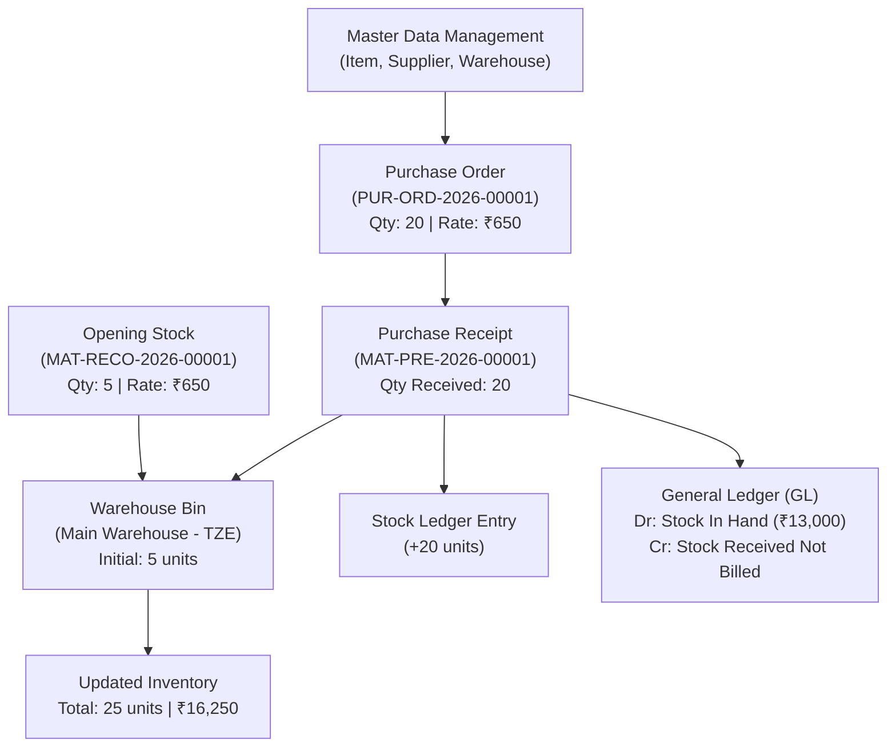

# Project Report: Implementation of an Inventory and Procurement Management System Using ERPNext

**Course:** Enterprise Business Systems (EBS)  
**Academic Degree:** Bachelor of Technology (B.Tech) — Computer Science and Engineering  
**Project Title:** Implementation of an Inventory and Procurement Management System Using ERPNext  
**Fictional Enterprise:** TechZone Electronics (Retail & Distribution, India)  

---

## Executive Summary

Enterprise Business Systems (EBS) serve as the operational backbone of modern organizations, integrating cross-functional workflows, establishing unified data repositories, and automating transactional record-keeping. This report presents the design, containerized deployment, configuration, and verification of an Inventory and Procurement Management System implemented using the open-source **ERPNext** system. 

Using a representative business scenario for an electronics retail firm, **TechZone Electronics**, this project models the procurement lifecycle: establishing master data, seeding an opening inventory of 5 units via formal Stock Reconciliation, issuing a Purchase Order for 20 units at ₹650 each, and executing a Goods Receipt via Purchase Receipt. The implementation confirms automated stock updates from 5 to 25 units, synchronized perpetual inventory accounting, and comprehensive ledger tracking.

---

## 1. Introduction

Traditional business operations frequently suffer from disparate information silos where purchasing, warehouse operations, and financial accounting operate independently. These disconnects lead to stockouts, inventory holding overheads, duplicate purchasing, and manual reconciliation errors.

Enterprise Resource Planning (ERP) systems mitigate these issues through:
1. **Centralized Data Storage:** Single system of record for all business entities.
2. **Standardized Business Workflows:** Enforced procedural controls across organizational boundaries.
3. **Automated Cross-Module Posting:** Immediate reflection of physical transactions in financial and operational ledgers.

This project implements a streamlined, fully functional ERP environment using **ERPNext**, demonstrating how small-to-medium retail enterprises can achieve operational excellence without prohibitive software licensing costs.

---

## 2. Project Objectives

The project accomplishes the following objectives:
1. **Containerized Deployment:** Deploy ERPNext locally using Docker Compose, ensuring environmental consistency, data persistence, and isolation from the host OS.
2. **Master Data Modeling:** Structure and link essential ERP masters, including Company, Supplier Group, Supplier, Item Group, Item Master, Warehouse, and Price Lists.
3. **Procurement Workflow Execution:** Execute an end-to-end purchasing cycle consisting of Purchase Order creation, validation, submission, and Purchase Receipt execution.
4. **Inventory & Valuation Control:** Model perpetual inventory valuation, proving that physical warehouse bins and stock ledgers update exclusively through authorized document transactions.
5. **Operational Audit & Reporting:** Demonstrate native reporting tools (Stock Balance, Stock Ledger, and Purchase Order Analysis) to substantiate end-to-end data integrity.

---

## 3. Technology Stack & Architecture

### 3.1 Software Infrastructure

* **ERP System:** ERPNext v16 (Frappe Framework)
* **Database Management System:** MariaDB 11.8 (InnoDB, utf8mb4 character set)
* **In-Memory Caching & Queue:** Redis 6.2 (Alpine Linux)
* **Web Server & Reverse Proxy:** Nginx (Containerized Frontend)
* **Container Orchestration:** Docker Compose v2.29+
* **Host Operating System:** Microsoft Windows 11 (WSL 2 container backend)

### 3.2 Service Topology

The environment is architected into containerized microservices:
* `db`: Dedicated MariaDB container with persistent storage volume `db-data`.
* `redis-cache` & `redis-queue`: High-speed caching for session data and asynchronous task scheduling.
* `backend`: Python application server executing Frappe/ERPNext business logic.
* `frontend`: Nginx web server handling static asset caching, SSL termination, and reverse proxying to port 8080.
* `scheduler` & `queue-workers`: Asynchronous background processing for automated tasks and notification queues.
* `create-site` & `configurator`: One-shot initialization containers ensuring automated database schema installation and common site configuration.

---

## 4. Fundamental EBS Concepts Demonstrated

### 4.1 Master Data Management (MDM)
Master data provides the context for business transactions. In this project:
* **Item Master (`KEY-001`):** Defines physical attributes, default warehouse location, stock tracking flags, and inventory valuation criteria.
* **Supplier Master (`ABC Electronics Distributors`):** Centralizes vendor attributes, default payment terms, tax IDs, and transaction history.
* **Warehouse Hierarchy:** Structures physical storage locations under a unified company tree (`All Warehouses -> Main Warehouse - TZE`).

### 4.2 Document Flow & Process Integration
ERP systems enforce standard document hierarchies. A transaction begins with an intent-to-buy document (**Purchase Order**), which establishes quantities, agreed rates, and delivery dates. When physical goods arrive, a fulfillment document (**Purchase Receipt**) is created directly against the PO. The system maps existing data fields, preventing manual re-entry errors and providing end-to-end traceability.

### 4.3 Perpetual Inventory & Automated Accounting
Under perpetual inventory control:
* Each inventory movement immediately generates an immutable **Stock Ledger Entry (SLE)**.
* Financial journal entries are automatically created without manual bookkeeper intervention:
  $$\text{Debit: Stock In Hand (Asset)} \quad \text{₹13,000}$$
  $$\text{Credit: Stock Received But Not Billed (Liability)} \quad \text{₹13,000}$$

---

## 5. Master Data Implementation

The master records were configured within the company context of **TechZone Electronics**:

| Master Entity | Record Name / Identifier | Key Attributes & Configuration |
| :--- | :--- | :--- |
| **Company** | `TechZone Electronics` | Country: India, Currency: INR, Abbreviation: `TZE`, Chart of Accounts: Standard |
| **Supplier Group** | `Electronics Suppliers` | Parent: `All Supplier Groups` |
| **Supplier** | `ABC Electronics Distributors` | Group: `Electronics Suppliers`, Supplier Type: Company, Country: India |
| **Item Group** | `Computer Accessories` | Parent: `All Item Groups` |
| **Item Master** | `Wireless Keyboard` (`KEY-001`) | UOM: `Nos`, Maintain Stock: Yes, Default Warehouse: `Main Warehouse - TZE` |
| **Warehouse** | `Main Warehouse` (`Main Warehouse - TZE`) | Company: `TechZone Electronics`, Parent: `All Warehouses - TZE` |
| **Price List** | `Standard Buying` | Currency: INR, Price: ₹650.00 for `KEY-001` |
| **Reorder Setting** | `Item Reorder` on `KEY-001` | Warehouse: `Main Warehouse - TZE`, Reorder Level: 30, Reorder Qty: 20 |

---

## 6. Business Transaction Workflow & Verification

The core demonstration scenario tests procurement and inventory tracking for `KEY-001` (Wireless Keyboard).

### Step 1: Initial Stock Establishment
* **Document:** Stock Reconciliation `MAT-RECO-2026-00001`
* **Purpose:** Opening Stock
* **Difference Account:** `Temporary Opening - TZE`
* **Input:** Quantity: 5 units | Valuation Rate: ₹650.00
* **Verification:** Stock Balance report confirmed an initial holding of 5 units valued at ₹3,250.00.

### Step 2: Purchase Order Creation & Submission
* **Document:** Purchase Order `PUR-ORD-2026-00001`
* **Supplier:** ABC Electronics Distributors
* **Line Item:** 20 units of `KEY-001` at ₹650.00 per unit
* **Commercial Total:** ₹13,000.00
* **Status:** `To Receive and Bill` (Commercial commitment established; no stock increase).

### Step 3: Purchase Receipt Execution
* **Document:** Purchase Receipt `MAT-PRE-2026-00001`
* **Workflow Source:** Mapped from `PUR-ORD-2026-00001`
* **Warehouse:** Main Warehouse - TZE
* **Quantity Received:** 20 units
* **Status:** `To Bill`
* **PO Status Update:** `PUR-ORD-2026-00001` automatically marked **100% Received**.

### Step 4: Final Stock & Ledger Verification

The transactions yielded the following verified state across the system:

| Metric | Pre-Transaction | Transaction Delta | Post-Transaction State |
| :--- | :---: | :---: | :---: |
| **Physical Stock in Bin** | 5 units | +20 units | **25.0 units** |
| **Average Valuation Rate** | ₹650.00 | ₹650.00 | **₹650.00** |
| **Total Stock Value** | ₹3,250.00 | +₹13,000.00 | **₹16,250.00** |
| **PO Received Percentage** | 0% | +100% | **100.0%** |
| **Stock Ledger Audit Trail** | 1 Entry (Opening) | +1 Entry (PR) | **2 Immutable Entries** |

---

## 7. Operational Reporting & Low-Stock Monitoring

### 7.1 Stock Balance Report
The Stock Balance report aggregates opening balances, incoming receipts, outgoing issues, and closing valuation. The query verifies:
* **Item:** `KEY-001`
* **In Qty:** `20.0`
* **Balance Qty:** `25.0`
* **Balance Value:** `₹16,250.00`

### 7.2 Stock Ledger Report
The Stock Ledger report presents a sequential audit log:
1. `MAT-RECO-2026-00001` (Opening Stock) -> In: `5.0` | Running Balance: `5.0`
2. `MAT-PRE-2026-00001` (Purchase Receipt) -> In: `20.0` | Running Balance: `25.0`

### 7.3 Purchase Order Analysis
The Purchase Order Analysis report confirms that `PUR-ORD-2026-00001` has zero pending quantities, reflecting 100% receipt fulfillment while highlighting a pending billing balance of ₹13,000 ready for Accounts Payable invoice matching.

### 7.4 Inventory Reorder Level Monitoring
To demonstrate exception-based inventory planning, an automated reorder point of **30 units** was established for `KEY-001`. Since the current stock stands at **25 units**, the item falls below the safety buffer, triggering low-stock replenishment recommendations via ERPNext's Material Request system.

---

## 8. Data Persistence & Reliability Testing

Reliability testing was conducted by restarting the container stack (`docker compose restart`). Upon stack reboot, all MariaDB tables, Redis caches, and Frappe site configs re-synchronized immediately:
* Master data remained intact.
* Transactional documents retained their submitted (`docstatus = 1`) state.
* Stock bins and report queries maintained the verified 25-unit balance.

---

## 9. Conclusion

This mini-project demonstrates the practical realization of Enterprise Business Systems concepts through ERPNext. By modeling the purchasing and warehousing lifecycle of an electronics retailer, the project highlights the advantages of enterprise systems over manual methods: complete data integrity, eliminated redundant data entry, automated financial and stock ledger synchronization, and robust audit trails.

The project successfully delivers a reproducible, fully verified ERP solution adhering to college academic standards and industry best practices.
